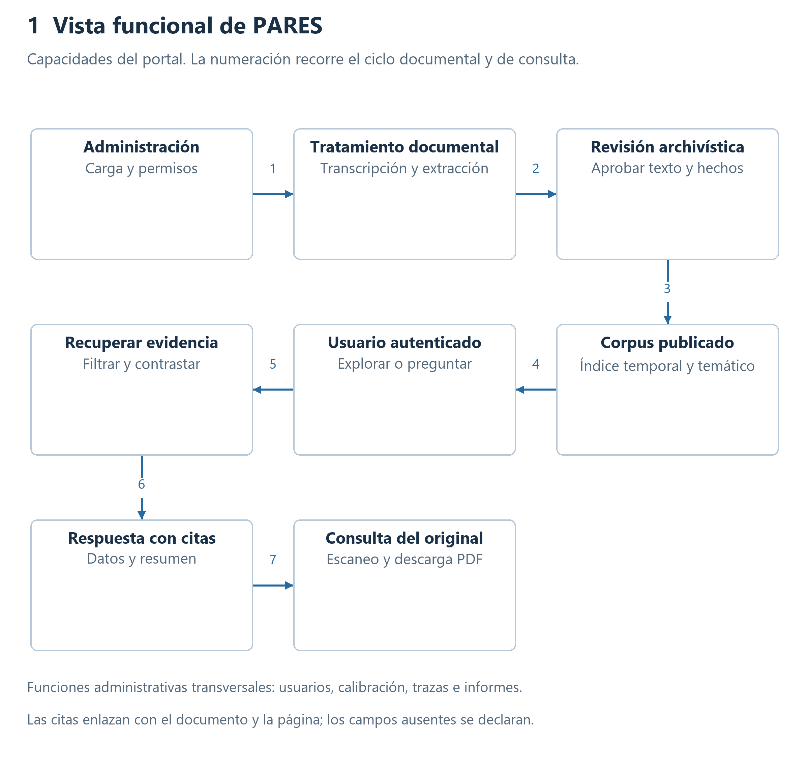
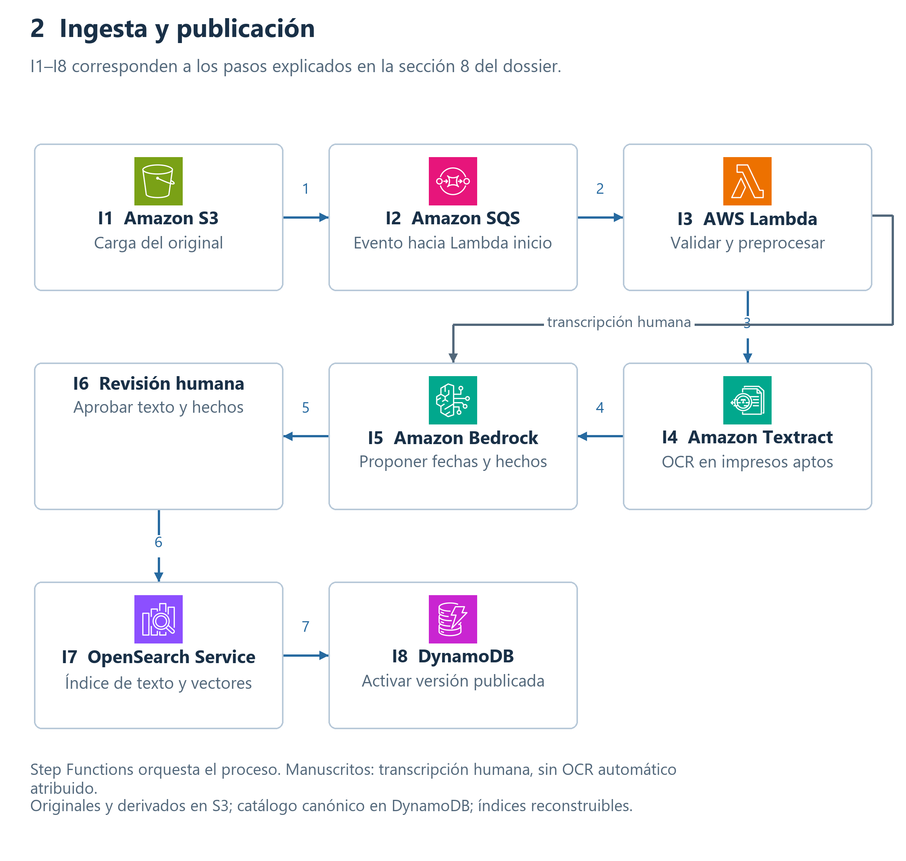
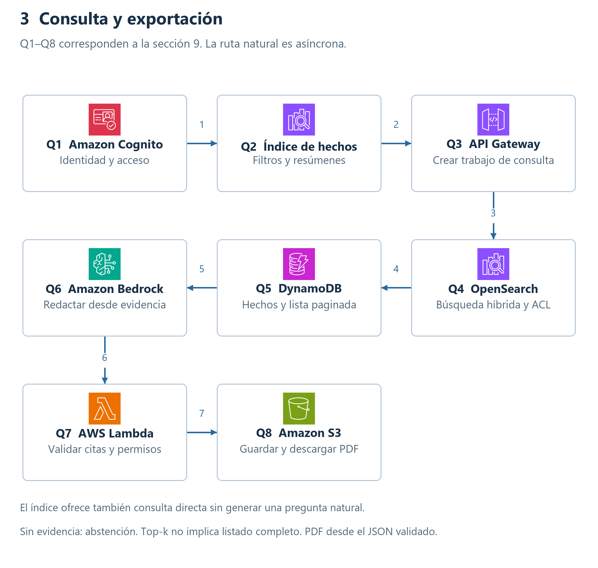
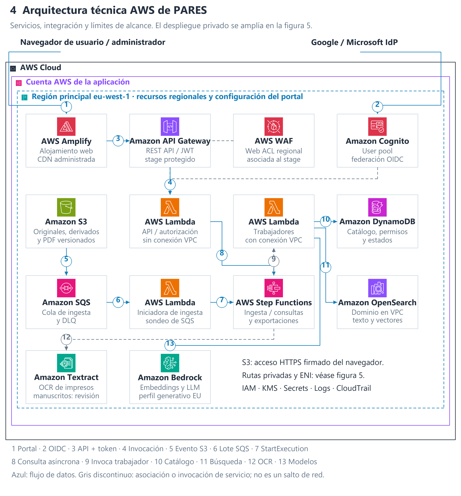
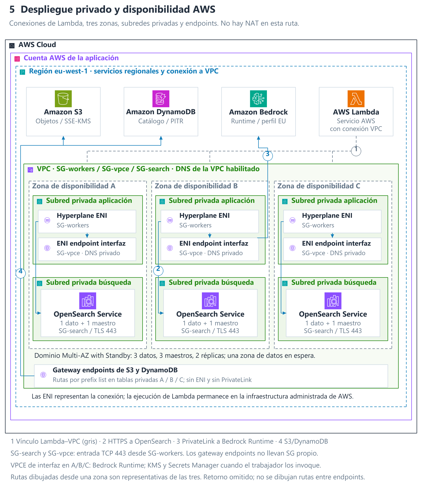
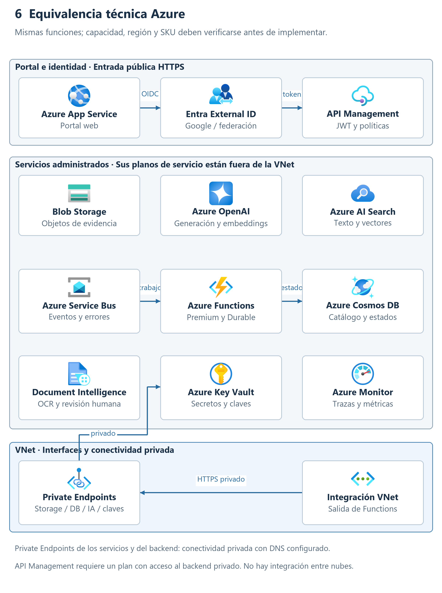

# PARES Arquitectura RAG en AWS

Alumno: German Dario Realpe Zambrano. Universidad: PONTIA.

Máster en IA, Cloud Computing & DevOps 0226. Materia: Arquitecturas con IA.

Actividad final. Código: PARES-ARQ-001. Versión: 1.1. Fecha: 8 de noviembre de 2026.

Estado: propuesta de diseño. AWS es la plataforma principal; Azure se presenta como alternativa técnica equivalente.

## Índice

1. Control documental y resumen de la propuesta.
2. Objetivo, alcance y supuestos.
3. Interesados y necesidades.
4. Requisitos y trazabilidad de los entregables.
5. Decisiones y justificación de la arquitectura RAG.
6. Vista funcional y casos de uso.
7. Datos, metadatos y procedencia.
8. Flujo de ingesta y actualización.
9. Flujo de consulta y generación de PDF.
10. Componentes AWS e integraciones.
11. Despliegue, red y seguridad.
12. Control y evaluación de modelos.
13. Monitorización, registros y trazas.
14. Alta disponibilidad y recuperación.
15. Costes, capacidad y evolución.
16. Diagramas técnicos AWS y equivalencia Azure.
17. Validación y riesgos pendientes.
18. Referencias y anexos técnicos.

## 1. Control documental y resumen de la propuesta

PARES necesita transformar escaneos históricos en información que se pueda localizar, contrastar y resumir. Se propone una arquitectura RAG con búsqueda híbrida y un catálogo de hechos: primero se recupera evidencia autorizada y después se redacta la respuesta. Cada dato conserva su referencia al documento y a la página de origen.

La ingesta y la consulta son procesos separados. Los originales se conservan en Amazon S3; las transcripciones y los hechos revisados se registran en un catálogo; Amazon OpenSearch Service permite buscar texto y vectores; Amazon Bedrock participa en la extracción y en la generación. La aplicación web ofrece un índice de hechos, preguntas en lenguaje natural y descarga de resultados en PDF.

La lectura histórica requiere una precaución decisiva: Amazon Textract no admite reconocimiento manuscrito en castellano. En la primera versión, los manuscritos pasan por transcripción humana en el portal administrativo. El OCR asiste sobre impresos compatibles; los nombres, fechas y hechos se revisan antes de publicar. Un motor HTR especializado podrá incorporarse cuando demuestre calidad sobre este corpus [R4].

| Versión | Fecha | Cambio | Estado |
| --- | --- | --- | --- |
| 1.0 | 08/11/2026 | Requisitos, decisiones, datos, flujos, seis diagramas y equivalencia Azure. | Propuesta de diseño. |
| 1.1 | 08/11/2026 | Diagramas AWS con jerarquía cloud/cuenta/región, zonas, subredes, ENI y controles de red; referencias oficiales. | Propuesta revisada. |

Este dossier sigue la organización de descripción arquitectónica ISO/IEC/IEEE 42010:2022 y 15289:2019 como referencias.

## 2. Objetivo alcance y supuestos

El objetivo es consultar fuentes documentales escaneadas fechadas entre 1500 y 1600 y obtener resultados comprensibles, con procedencia y tratamiento explícito de la incertidumbre. Se incluyen nuevas ingestas, extracción de fechas y hechos, índice navegable, resumen por hecho, consultas naturales, exportación PDF e identidad federada.

El alcance comprende el diseño funcional, de datos, componentes, despliegue, seguridad y operación. No incluye digitalizar físicamente los archivos, conectar una API real de PARES, desplegar recursos de pago ni demostrar precisión con un corpus que no se ha aportado. El conocimiento de los modelos no sustituye a las fuentes del archivo.

| Supuesto de diseño | Valor propuesto | Consecuencia |
| --- | --- | --- |
| Región principal | AWS eu-west-1, Irlanda. | Datos persistentes regionales; inferencia generativa mediante perfil europeo. |
| Ingesta piloto | 10.000 páginas iniciales y 1.000 nuevas al mes. | Hipótesis para capacidad y costes; no volumen real de PARES. |
| Uso piloto | 5.000 preguntas al mes y 20 usuarios concurrentes. | Consultas largas asíncronas y límites de consumo. |
| Idioma | Castellano histórico; otros idiomas se etiquetan y revisan. | No se presupone precisión de embeddings ni OCR en grafías históricas. |
| Acceso | Usuarios autenticados; permisos por colección. | El backend verifica autorización en búsqueda, citas y descargas. |
| Residencia | Persistencia y recuperación en la UE. | Perfil de inferencia europeo; prohibido sustituirlo silenciosamente por uno global. |

El intervalo 1500–1600 se aplica a la fecha del documento, incluidos ambos extremos. Un documento de ese periodo puede mencionar hechos de otros años. Los documentos sin fecha segura quedan pendientes de clasificación; no se les asigna una fecha inventada.

## 3. Interesados y necesidades

| Interesado | Necesidad | Respuesta del diseño |
| --- | --- | --- |
| Investigador o usuario | Encontrar hechos, contrastar fuentes y descargar resultados. | Índice con filtros, preguntas, citas y PDF. |
| Archivero revisor | Preservar el sentido histórico y corregir transcripciones. | Original visible junto al texto, variantes y aprobación registrada. |
| Administrador | Cargar documentos y gestionar acceso y calidad. | Panel de cargas, usuarios, evaluaciones, trazas e informes. |
| Ingeniería y operación | Detectar errores y restaurar el servicio. | Estados persistidos, alarmas, colas y procedimiento de recuperación. |
| Responsable de seguridad | Controlar permisos y uso de datos. | Identidad federada, mínimo privilegio, cifrado y auditoría. |
| Evaluador académico | Entender y comprobar la propuesta. | Matriz de cobertura, vistas numeradas y decisiones justificadas. |

El revisor es una responsabilidad dentro del rol administrador, no un tercer rol obligatorio del enunciado. Podrá separarse en producción para aplicar doble revisión.

## 4. Requisitos y trazabilidad de los entregables

### 4.1 Matriz de requisitos

Esta matriz y el índice se establecieron antes de cerrar los componentes y los diagramas. Los criterios de aceptación describen verificaciones previstas para una implementación; no resultados de pruebas ejecutadas.

| ID | Requisito | Sección de desarrollo | Evidencia de aceptación prevista |
| --- | --- | --- | --- |
| RF01 | Conservar escaneos de 1500 a 1600 e incorporar nuevos documentos | 7 y 8 | Original inmutable, versión y nueva ingesta trazable. |
| RF02 | Entender fuentes no estructuradas | 7, 8 y 12 | Transcripción revisada, extracción de hechos y control de calidad. |
| RF03 | Generar metadatos temporales y vincular hechos | 7 y 8 | Fecha original, intervalo normalizado, hecho y referencia de página. |
| RF04 | Índice navegable y resúmenes por hecho | 6 y 9 | Filtros temporales y temáticos, lista paginada y resumen citado. |
| RF05 | Consultas en lenguaje natural | 5, 6 y 9 | Recuperación, respuesta basada en evidencia y abstención. |
| RF06 | Resolver la consulta naval del enunciado | 9 y 18 | Todos los atributos solicitados, ausencias explícitas y alcance del listado. |
| RF07 | Respuesta en texto y PDF descargable | 9 y 11 | Mismo contenido, citas y descarga autorizada. |
| RF08 | Acceso federado Google o Microsoft | 10 y 11 | Identidad federada y token validado. |
| RF09 | Administrar cargas, usuarios, calibración, trazas e informes | 6, 11, 12 y 13 | Matriz de roles y operaciones protegidas en backend. |
| RF10 | Usuario con acceso al buscador y consultas naturales | 6 y 11 | Acciones permitidas y denegación de administración. |
| RN01 | Calidad, fidelidad y procedencia | 7, 9 y 12 | Citas por afirmación, incertidumbre y evaluación separada. |
| RN02 | Seguridad de datos e integraciones | 11 | Autorización extremo a extremo, cifrado y límites de confianza. |
| RN03 | Operación y continuidad | 13 y 14 | Alarmas, reintentos, respaldo y restauración. |
| RN04 | Diagramas claros y tecnologías correctas | 6, 8, 9, 10 y 16 | Figuras legibles, iconos oficiales y coherencia con los flujos. |

### 4.2 Cobertura de los diecinueve entregables

| Entregable | Evidencia en el dossier |
| --- | --- |
| 1. Diagrama y detalle funcional | Sección 6 y figura 1. |
| 2. Datos y tratamiento | Secciones 7 y 8. |
| 3. Integraciones | Sección 10 y anexo de contratos en 18. |
| 4. Diagrama técnico de alto nivel | Figura 4 y sección 10. |
| 5. Detalle técnico y uso | Secciones 10 y 11. |
| 6. Seguridad | Sección 11. |
| 7. Registros y trazas | Sección 13. |
| 8. Control y calibración de modelos | Sección 12. |
| 9. Monitorización funcional y técnica | Sección 13. |
| 10. Disponibilidad y recuperación | Sección 14. |
| 11. Justificación RAG | Sección 5. |
| 12. Flujo funcional explicado | Secciones 8 y 9; figuras 2 y 3. |
| 13. Arquitectura cloud | Figuras 4, 5 y 6. |
| 14. Descripción de componentes | Sección 10. |
| 15. Flujo de datos claro | Pasos I1–I8 y Q1–Q8, figuras 2 y 3. |
| 16. Documento de Google | Documento PARES Arquitectura RAG en AWS enlazado en 18. |
| 17. Copia local | Documentos/ActividadFinal.md. |
| 18. Diagramas incorporados | Seis imágenes integradas y fuentes .drawio en Documentos/diagramas. |
| 19. Versiones técnicas AWS y Azure | Sección 16, figuras 5 y 6 y tabla de equivalencias. |

## 5. Decisiones y justificación de la arquitectura RAG

### 5.1 Por qué RAG híbrido

Se elige RAG híbrido con filtros y catálogo de hechos porque las preguntas combinan significado, nombres históricos y relaciones concretas. La búsqueda léxica encuentra una nave por su nombre; los vectores ayudan a localizar pasajes con formulaciones distintas; los metadatos delimitan fechas, colección y tipo de hecho. La respuesta se genera a partir de los pasajes recuperados y de los registros aprobados.

| Alternativa | Ventaja | Límite para PARES | Decisión |
| --- | --- | --- | --- |
| Buscador léxico | Nombres, fechas y filtros precisos. | No redacta respuestas ni relaciona expresiones semánticas. | Mantener como parte de la recuperación. |
| LLM sin recuperación | Redacción inmediata. | No prueba los datos ni incorpora ingestas con procedencia. | Descartar para respuestas históricas. |
| RAG solo vectorial | Localiza pasajes por significado. | Puede omitir nombres exactos y producir listados incompletos. | Insuficiente por sí solo. |
| RAG híbrido y catálogo | Combina contexto, coincidencias y relaciones verificadas. | Requiere gobierno de datos y evaluación. | Seleccionado. |
| Ajuste fino del generador | Puede adaptar estilo o tareas concretas. | No sustituye referencias ni actualizaciones del corpus. | Fuera del alcance inicial. |

### 5.2 Decisiones técnicas

ADR01. Se usa una orquestación explícita en Step Functions y funciones pequeñas. No se necesitan agentes autónomos con herramientas abiertas para buscar, resumir y exportar. La secuencia controlada facilita explicar errores y auditar el uso de evidencia.

ADR02. Se seleccionan OpenSearch Service provisionado en VPC y DynamoDB. OpenSearch mantiene índices derivados de texto, vectores y hechos; DynamoDB conserva estados, permisos y registros canónicos de hechos. Esta separación evita convertir el buscador en la única copia de la información aprobada.

ADR03. Se conserva el control de ingesta y recuperación en la aplicación. No se incorpora Bedrock Knowledge Bases en paralelo: la revisión humana, el catálogo de relaciones y la publicación por versión necesitan un recorrido explícito. Un servicio RAG administrado sigue siendo una alternativa si reduce operación sin perder esos controles.

ADR04. Se propone Cohere Embed Multilingual v3 en Bedrock, con 1.024 dimensiones, por el carácter multilingüe del fondo. Los fragmentos se dimensionan para respetar su límite de entrada; se utilizan tipos de entrada distintos para documento y consulta [R5]. Titan Text Embeddings V2 queda como comparador, no como un segundo vectorizador simultáneo. Cambiar de modelo exige reindexar.

ADR05. Para extracción y redacción se propone Amazon Nova Pro mediante un perfil de inferencia europeo accesible desde Irlanda. El identificador de modelo y el perfil se fijan en configuración tras comprobar permisos y ciclo de vida. La disponibilidad consultada distingue inferencia regional y geográfica; no se afirma que Nova Pro procese localmente en Irlanda [R6].

ADR06. La fragmentación inicial sigue párrafos, secciones y páginas. Se conservan relaciones padre–hijo para recuperar contexto. Late chunking queda fuera de la primera versión: el material docente lo presenta como alternativa, pero adoptarlo exige otro análisis de modelo, contexto y calidad.

## 6. Vista funcional y casos de uso



Figura 1. Separa las capacidades de consulta del usuario y las funciones de administración. Las referencias permiten volver del resultado al documento original.

El usuario inicia sesión, filtra hechos por fecha, tema, lugar o colección y abre un resumen con fuentes. También puede formular una pregunta y examinar datos estructurados y citas. La descarga PDF conserva el contenido, sus fuentes y las advertencias de incertidumbre.

El administrador carga nuevos escaneos, revisa el resultado de extracción, corrige transcripciones, aprueba hechos y publica versiones. Desde el mismo portal puede gestionar permisos de la aplicación, revisar evaluaciones de modelos y consultar trazas e informes de utilización. Cambiar una contraseña de Google o Microsoft sigue siendo responsabilidad del proveedor de identidad.

| Operación | Usuario | Administrador |
| --- | --- | --- |
| Buscar hechos y formular preguntas | Sí, sobre colecciones permitidas. | Sí, según permiso de colección. |
| Ver escaneos y descargar PDF | Sí, previa autorización. | Sí, previa autorización. |
| Subir, transcribir, revisar y publicar | No. | Sí, con auditoría. |
| Asignar acceso y suspender usuarios en PARES | No. | Sí; no puede autoelevar permisos sin control. |
| Promover configuración de modelos | No. | Sí, tras evaluación registrada. |
| Ver trazas e informes globales | No. | Sí, con contenido sensible redactado. |

La administración de roles usa un registro autorizado por el servidor. Los grupos de Cognito sirven como señal de rol, pero el backend consulta la autorización vigente para operaciones sensibles; no confía en parámetros enviados por el navegador.

## 7. Datos metadatos y procedencia

### 7.1 Capas y fuente canónica

| Capa | Contenido | Ubicación y responsabilidad |
| --- | --- | --- |
| Original | PDF, TIFF, JPEG o PNG recibido; huella y procedencia. | S3 con versionado; evidencia primaria que no se sobrescribe. |
| Derivados | Imágenes preprocesadas, texto OCR y transcripción revisada. | S3; cada versión enlaza al original. |
| Catálogo | Documentos, hechos, entidades, relaciones, permisos y revisión. | DynamoDB; registro canónico de la publicación aprobada. |
| Índices | Texto, vectores, facetas y copia de hechos publicables. | OpenSearch; reconstruible desde catálogo y derivados. |
| Salidas | Respuesta JSON, citas y PDF. | S3; propiedad del solicitante y retención limitada. |

Las correcciones no borran la transcripción anterior. Se conserva texto diplomático, texto normalizado para búsqueda y propuesta de corrección. Las expansiones de abreviaturas y lecturas dudosas quedan marcadas. Se evita modernizar nombres de forma que se pierda la grafía original.

### 7.2 Entidades y reglas

Documento: document_id, colección, signatura, versión S3, SHA-256, idioma, permisos, fecha documental y estado. Página: page_id, número de imagen, folio original si existe, disposición y transcripciones. Fragmento: chunk_id, texto, páginas, coordenadas cuando existan, versión de extracción y modelo vectorial.

Hecho: event_id, denominación, tema, intervalo temporal, lugares, entidades y referencias. Participación: relación entre hecho y nave/persona/unidad militar, con atributos y evidencia por campo. Una tabla de DynamoDB puede almacenar documentos y otra hechos/participaciones; las claves se diseñan por patrones de consulta, sin exigir uniones relacionales.

La fecha se representa con expresión original, inicio, fin, precisión y calendario cuando pueda determinarse. «Hacia 1550» produce un intervalo documentado como estimación del revisor, no un día exacto. «Sin fecha» conserva valores nulos. Las unidades originales, como toneles, se mantienen; cualquier conversión requiere una regla citada y no se presupone equivalencia moderna.

Las variantes de nombres se relacionan con un identificador estable. La fusión de dos naves con nombres similares exige evidencia; una coincidencia textual no basta. La confianza del modelo y la validación humana se registran por separado, porque una probabilidad alta no equivale a verdad histórica.

Los hechos conocidos se vinculan a un catálogo de autoridades gestionado por el archivero. Cada autoridad externa conserva URL, versión o fecha de consulta y procedencia. La primera versión no consulta Internet durante las preguntas del usuario: solo usa el corpus y las autoridades aprobadas.

### 7.3 Publicación coherente

El catálogo usa estados RECIBIDO, VALIDANDO, TRANSCRIBIENDO, EN_REVISION, INDEXANDO, PUBLICADO y ERROR. Cada ejecución lleva document_id, version_id, pipeline_version y trace_id. Los mensajes transportan identificadores y rutas S3; no el documento completo.

La publicación usa una versión de corpus. Se preparan registros canónicos e índices de una nueva versión y se comprueban recuentos y referencias. Solo después se cambia el manifiesto activo mediante escritura condicional. Cada consulta fija esa versión y busca exclusivamente registros de ella. Este diseño evita depender de una transacción inexistente entre DynamoDB y OpenSearch; para el piloto se asume una publicación por lotes y se acepta su coste temporal de duplicación.

Una retirada urgente marca el documento como revocado en el catálogo. El backend vuelve a comprobar la autorización y la revocación antes de devolver resultados, citas o PDF, aunque el índice aún contenga una copia. La siguiente publicación elimina sus derivados. Los PDF ya descargados no pueden revocarse retroactivamente.

## 8. Flujo de ingesta y actualización



Figura 2. Flujo I1–I8 desde la carga hasta la publicación. La revisión humana es obligatoria para manuscritos y para los datos históricos extraídos en la versión inicial.

I1. El administrador solicita una carga. La API comprueba rol y colección y entrega un formulario de carga S3 firmado, con clave única y restricciones de tamaño. El navegador envía el archivo al área de entrada; todavía no es consultable.

I2. S3 notifica la creación a SQS. Una Lambda iniciadora registra el trabajo mediante escritura condicional y arranca Step Functions Standard. El identificador combina objeto y versión; los eventos duplicados no crean una segunda publicación. La deduplicación adicional por SHA-256 considera la colección y el origen.

I3. Se verifica formato real, tamaño, integridad, ausencia de protección incompatible y contenido peligroso. Como política de aplicación se proponen lotes de hasta 200 páginas y 100 MB; límites superiores requieren división. Lambda procesa páginas acotadas y se usan objetos S3 para evitar exceder cargas de los servicios. Los originales se conservan antes de mejorar contraste, inclinación y disposición.

I4. Para impresos compatibles se invoca Textract de forma asíncrona y se espera su resultado con estados de espera y consulta. Para manuscritos históricos se abre una tarea de transcripción humana. La confianza OCR solo ayuda a priorizar; no exime de revisión histórica. La pantalla enfrenta escaneo y texto.

I5. Bedrock propone entidades, fechas, relaciones y resúmenes en JSON. Una función valida el esquema, las referencias y los rangos permitidos. El texto del documento se delimita como evidencia, sin tratar sus instrucciones como órdenes. Los datos no justificables se mantienen como nulos o pendientes.

I6. El administrador revisa transcripción, hechos, variantes y citas. La ejecución termina en EN_REVISION mientras espera; no mantiene una Lambda bloqueada. La aprobación autenticada inicia la fase de publicación con los identificadores de revisión. Los campos dudosos pueden excluirse sin impedir conservar el documento.

I7. Una función genera fragmentos de unas 300–350 tokens, con solapamiento inicial de unas 40, respetando párrafos. La cabecera contextual y el fragmento completo deben caber en 512 tokens para el modelo seleccionado. No se trunca silenciosamente: se subdivide antes de vectorizar. Se generan embeddings y se indexan fragmentos y hechos.

I8. Se valida la nueva versión y se activa el manifiesto. Se actualizan el índice temático/temporal y los estados de publicación. El administrador recibe el estado en el portal. Un fallo conserva la versión anterior activa.

Las llamadas transitorias usan hasta tres intentos con espera exponencial y jitter. Errores de formato van a rechazo; salidas inválidas del modelo y lecturas dudosas van a revisión. SQS dispone de DLQ para fallos de inicio; los fallos posteriores de Step Functions se guardan en el catálogo y generan una alarma. Reanudar un documento usa la misma versión de entrada y crea una ejecución trazable.

## 9. Flujo de consulta y generación de PDF



Figura 3. Flujo Q1–Q8. La ruta estructurada complementa al RAG para obtener listados completos dentro del corpus publicado y autorizado.

Q1. El usuario se autentica. Cognito federa Google y Microsoft mediante OIDC; el portal usa Authorization Code con PKCE. La API valida firma, emisor, audiencia o cliente correspondiente, caducidad y permisos. El servidor determina las colecciones autorizadas [R7].

Q2. El buscador inicial consulta el índice de hechos con filtros y facetas. Ordena por fecha o relevancia y devuelve páginas de resultados. Al abrir un hecho, recupera su ficha canónica y un resumen revisado con referencias. No requiere generar un resumen nuevo en cada visita.

Q3. Para una pregunta natural, POST /queries crea un trabajo y devuelve 202 con query_id. Un flujo de consulta en Step Functions ejecuta recuperación y generación; el portal consulta GET /queries/{id}. Esta ruta evita que la redacción extensa dependa del tiempo máximo de una petición HTTP. Solo el propietario del trabajo o un administrador autorizado puede leerlo.

Q4. La aplicación identifica fecha, tema y entidades, y solicita aclaración si el hecho es ambiguo. Genera un embedding de consulta y recupera candidatos mediante BM25 y búsqueda vectorial, siempre con filtros de autorización, estado y versión. La fusión inicial normaliza puntuaciones en un search pipeline; el peso inicial es 0,5 para cada rama y se calibra con datos de referencia [R8].

Q5. Para preguntas explicativas se seleccionan hasta ocho pasajes de los 40 candidatos iniciales, evitando duplicados y manteniendo contexto de página. Para «todas las naves de un hecho», se fija event_id y se consulta la partición de participaciones del catálogo de esa versión, con lectura paginada hasta agotar resultados. El top-k semántico no se utiliza como prueba de exhaustividad. Se indica que la cobertura alcanza el corpus disponible, no todos los archivos históricos.

Q6. Se construye un contexto con pasajes, datos y referencias. El prompt exige responder solo con evidencia, citar cada afirmación, distinguir contradicciones y usar «no consta» para campos ausentes. El LLM no ejecuta consultas arbitrarias: cualquier filtro sugerido debe pasar un esquema y una lista de operaciones permitidas.

Q7. Un validador comprueba que las citas existen, pertenecen al contexto autorizado y corresponden a la versión fijada. Comprueba también estructura y presencia de campos; esto no demuestra por sí solo que una cita respalde semánticamente la afirmación, por lo que esa fidelidad se evalúa con revisión humana. Si falta evidencia, se solicita aclaración o se responde «No se ha encontrado evidencia suficiente». Si se agota un límite, se comunica que el resultado es parcial y se ofrece paginación.

Q8. Si el usuario pide PDF, POST /queries/{id}/exports inicia un renderizado de la respuesta JSON ya validada. No se vuelve a preguntar al LLM. El PDF incluye pregunta, versión del corpus, fecha de generación, tabla o texto, referencias y limitaciones. El archivo queda en S3 con retención propuesta de siete días. Tras revalidar permisos se entrega una URL firmada de cinco minutos, tratada como credencial temporal; no se registra en logs.

### 9.1 Caso de aceptación de la consulta naval

La denominación «Batalla de San Miguel» se toma del enunciado. No se afirma su identificación histórica sin fuentes. Si existen varias coincidencias, el portal pide elegir fecha, lugar o ficha antes de recuperar participaciones.

La salida reserva un registro por nave con: nombre, año de construcción, arqueo y unidad original, capitán de mar, capitán de guerra, marinería, tercio embarcado y nombre del tercio, condición de capitana o almiranta, grupo asignado, capitán que manda el grupo y nave principal del grupo. Cada valor lleva su referencia o el estado «no consta»; las contradicciones conservan ambas lecturas.

La cabecera indica hecho seleccionado, versión de corpus, número total de registros autorizados y si se completó la paginación. Los grupos se presentan como «grupo 1», «grupo 2», etc., con correspondencia a su denominación original cuando exista. Si el agrupamiento es una organización editorial, se declara expresamente y no se atribuye al documento.

Sin corpus, el resultado correcto del ejemplo es explicar la falta de evidencia. No se incluyen nombres de barcos, cifras ni citas ficticias para aparentar una respuesta histórica.

## 10. Componentes AWS e integraciones



Figura 4. Arquitectura técnica de integración con iconos oficiales y límites AWS Cloud, cuenta y región. Los flujos 1–13 distinguen portal, federación, API, ingesta, orquestación y acceso a datos. AWS WAF aparece asociado al stage REST, no como un proxy independiente. La CDN de Amplify tiene distribución administrada global; Bedrock se invoca en la región principal y su perfil generativo puede procesar en otras regiones europeas autorizadas.

| Componente | Entrada y salida | Responsabilidad y elección |
| --- | --- | --- |
| AWS Amplify Hosting | Código del portal → web HTTPS. | Distribuye el frontal y su despliegue; evita operar servidores web. No representa Cognito. |
| Amazon Cognito | Federación Google/Microsoft → tokens. | Unifica identidad; la autorización documental se decide en backend. |
| Amazon API Gateway REST API | HTTPS autenticado → Lambda. | Expone contratos, autorización y límites; permite protección WAF sobre el stage. |
| AWS Lambda | Identificadores, JSON y rutas → operaciones acotadas. | Separa API, validación, extracción, recuperación y PDF. Los trabajos largos se orquestan. |
| Amazon S3 | Archivos → objetos versionados y descargas. | Conserva originales, derivados, evidencias y salidas con políticas distintas. |
| Amazon SQS | Evento S3 → mensaje y posible DLQ. | Absorbe picos y desacopla la carga del inicio del procesamiento. |
| AWS Step Functions Standard | Trabajo → estados y resultado. | Orquesta ingesta, consulta y exportación con errores explícitos. |
| Amazon Textract | Impresos compatibles → texto y disposición. | Asiste el OCR. No se usa como HTR castellano. |
| Amazon Bedrock | Texto/contexto → vectores o JSON. | Sirve embeddings, extracción y redacción con modelos separados por función. |
| Amazon OpenSearch Service | Índices y consulta → pasajes, facetas y hechos. | Combina coincidencia léxica y semántica en un dominio privado provisionado. |
| Amazon DynamoDB | Claves/versiones → registros y estados. | Catálogo canónico, participaciones, permisos, trabajos y manifiesto activo. |
| AWS IAM y KMS | Políticas y claves → acceso y cifrado. | Roles por función y protección criptográfica por finalidad. |
| AWS Secrets Manager | Configuración secreta → acceso controlado. | Guarda secretos de integración que no gestiona el propio servicio. El secreto del IdP se configura en Cognito. |
| AWS WAF | Petición HTTP → permitir o bloquear. | Protege el stage REST de la API con reglas y límites de tasa. No filtra el contenido de S3. |
| CloudWatch y CloudTrail | Métricas/eventos → alarmas y auditoría. | Distinguen operación de la aplicación y actividad de las API de AWS. |

Se elige una única ruta S3 → SQS → Lambda iniciadora → Step Functions. EventBridge y DataSync no son necesarios en el escenario inicial. Pueden incorporarse si hay ingestas externas o programadas, con una justificación adicional.

Las integraciones internas usan SDK de AWS, IAM y SigV4. Los modelos no reciben credenciales de usuario. El navegador solo accede al portal, a Cognito, a la API y a objetos S3 específicamente firmados; nunca accede directamente a OpenSearch o DynamoDB.

## 11. Despliegue red y seguridad

### 11.1 Topología y límites de confianza

La región principal es eu-west-1. Amplify sirve una entrada web pública; Cognito y API Gateway ofrecen endpoints públicos HTTPS autenticados. WAF se asocia al stage REST de la API. La autorización se aplica aunque una solicitud llegue sin pasar por el portal.

Las funciones que consultan OpenSearch se conectan a subredes privadas en tres zonas. El diagrama representa sus interfaces de red en la VPC, no el plano de control de Lambda. El dominio de OpenSearch usa acceso VPC, grupos de seguridad, HTTPS y control de acceso detallado. No tiene endpoint público [R9].

S3, DynamoDB, Bedrock y Step Functions son servicios regionales fuera de las subredes. S3 y DynamoDB se alcanzan desde las funciones VPC por gateway endpoints. Bedrock Runtime se alcanza por interface endpoints con DNS privado; Secrets Manager y KMS usan endpoints de interfaz cuando los invoca ese trabajador. Las políticas del endpoint limitan acciones y recursos [R10].

Se separan funciones API/iniciadoras sin conexión VPC, que llaman a Cognito, Step Functions y Textract, de trabajadores VPC que recuperan e indexan. No se presupone que una función en subred privada tenga Internet. La topología no necesita NAT en la ruta de recuperación; cualquier futura dependencia externa debe añadir su salida controlada y su coste.

### 11.2 Controles de seguridad

El portal usa PKCE, redirecciones registradas y protección frente a XSS; no incorpora un secreto OAuth en el navegador. El backend utiliza tokens de acceso y valida su uso previsto. Las cuentas administrativas requieren controles reforzados en el IdP y una aprobación de alta; registrarse con Google no concede administración.

Cada Lambda dispone de un rol específico. La función de búsqueda no publica documentos; la de exportación no cambia permisos; la de administración solo gestiona los usuarios de la aplicación y los grupos autorizados. La desactivación en el registro de permisos bloquea inmediatamente las operaciones nuevas, aunque el token todavía no haya expirado.

S3 aplica bloqueo de acceso público, TLS, versionado y cifrado SSE-KMS. DynamoDB y OpenSearch se cifran en reposo; OpenSearch activa cifrado entre nodos. Los buckets de entrada, evidencia y exportaciones tienen políticas separadas. Los clientes que cargan o descargan mediante URL firmada usan el endpoint S3 público bajo TLS y permisos limitados: una política que exija VPC para todo acceso impediría esa ruta y no debe aplicarse indiscriminadamente.

La autorización usa colección y documento. Se filtra antes de recuperar contexto y se revalida al responder. Las consultas al catálogo comprueban cada participación y su evidencia. El PDF no hereda una autorización permanente: se verifica el permiso antes de generar y antes de firmar la descarga.

Los escaneos y prompts son entradas no confiables. Las instrucciones encontradas dentro de ellos no pueden cambiar el rol del sistema, abrir herramientas ni obtener secretos. La recuperación usa filtros fijados por el servidor y nunca acepta una expresión de búsqueda arbitraria del modelo. La respuesta web y el PDF escapan HTML y deshabilitan recursos remotos durante el renderizado.

Las trazas excluyen tokens, URLs firmadas y texto completo por defecto. La conservación propuesta es de 30 días para diagnóstico y 365 para auditoría de cambios, sujeta a política institucional. Las identidades actuales de los usuarios se tratan como información personal; los escaneos históricos no se consideran automáticamente públicos por su antigüedad. La validación jurídica y de derechos de difusión corresponde a la institución.

## 12. Control y evaluación de modelos

### 12.1 Alimentación y calibración

El conocimiento se actualiza incorporando documentos aprobados e índices versionados. El modelo generativo no se reentrena en cada ingesta. La calibración inicial ajusta segmentación, pesos de recuperación, candidatos, contexto y prompt, manteniendo fijas las versiones durante cada evaluación.

Se propone un conjunto de 120 páginas revisadas y 60 preguntas, con variedad de grafías, legibilidad y tipos de hecho. Se separa por documento, no por fragmento: 80 páginas/40 preguntas para desarrollo y 40 páginas/20 preguntas para evaluación reservada. Es un tamaño piloto propuesto; no un conjunto ya construido. Las transcripciones de referencia requieren revisión archivística, especialmente en nombres y fechas.

| Aspecto | Métrica | Criterio propuesto de promoción |
| --- | --- | --- |
| OCR/HTR experimental | CER y WER frente a transcripción de referencia. | Informar por tipo de fuente; no habilitar publicación automática por una media global. |
| Fechas y entidades | Precisión y recall por campo; F1 complementaria. | Precisión ≥ 95 % en el conjunto reservado; todo hecho publicado sigue revisado. |
| Recuperación | Recall@20 sobre pasajes pertinentes etiquetados. | ≥ 90 %, informado por preguntas explicativas y estructuradas. |
| Fidelidad | Afirmaciones respaldadas / afirmaciones verificables. | ≥ 95 % con revisión humana; cero invenciones críticas de nombres o fechas en los casos de aceptación. |
| Citas | Referencias resolubles y respaldo semántico. | 100 % resolubles; ≥ 95 % respaldan la afirmación según revisión. |
| Abstención | Respuestas prudentes en preguntas sin evidencia. | ≥ 95 % y análisis de falsas abstenciones. |
| Acceso | Recuperaciones o descargas no autorizadas. | Cero en escenarios negativos definidos. |

Los umbrales son objetivos de diseño, no resultados. En muestras pequeñas se publican también numeradores, denominadores y casos fallidos; una puntuación aislada no demuestra generalización. Un segundo revisor resuelve desacuerdos de etiquetado.

### 12.2 Versiones y promoción

Cada ejecución registra pipeline_version, modelo de extracción, modelo generativo, modelo de embeddings, dimensión, prompt_version, parámetros, corpus_version y evaluación asociada. El índice de 1.024 dimensiones no admite mezclar embeddings de otro modelo como si fueran comparables.

La promoción sigue desarrollo → evaluación reservada → aprobación administrativa → publicación de configuración. Un cambio de embeddings construye un índice nuevo, reevalúa consultas y activa el manifiesto solo al terminar. Se conserva la configuración anterior para rollback. Cambios en nombre, fecha o procedencia de un hecho siempre generan nueva revisión.

La extracción utiliza temperatura baja y validación de JSON; un máximo de dos intentos de reparación precede a la revisión manual. La temperatura baja no garantiza ausencia de errores. Un reordenador adicional solo se introduce si mejora calidad con un coste y una latencia aceptables.

## 13. Monitorización registros y trazas

El portal administrativo distingue uso funcional, calidad histórica y salud técnica. Los informes se obtienen de eventos estructurados y agregados diarios; no requieren leer conversaciones completas.

| Vista | Indicador | Umbral inicial y acción |
| --- | --- | --- |
| Ingesta | Trabajos fallidos y antigüedad de pendientes. | Cualquier DLQ o ejecución fallida genera alarma; revisar pendientes mayores de 48 h. |
| Revisión | Páginas pendientes y tasa de corrección. | Tendencia semanal; reasignar revisión si crece la cola. |
| Consulta | Latencia p95 y respuestas parciales. | Objetivo: búsqueda < 3 s y respuesta natural < 60 s, bajo carga piloto. |
| Calidad | Consultas sin evidencia y citas rechazadas. | Analizar causas; no forzar al modelo a contestar para bajar la abstención. |
| Buscador | Estado del clúster, espacio libre y presión de memoria. | Estado rojo: intervención inmediata; amarillo persistente: revisar réplicas y capacidad. |
| Modelos | Throttling, errores y tokens por trabajo. | Limitar concurrencia y activar reintentos acotados. |
| Seguridad | Denegaciones, cambios de rol y descargas anómalas. | Investigar picos; suspender enlaces y permisos si procede. |
| Coste | Consumo diario y previsión mensual. | Alertas al 80 % y 100 % del presupuesto configurado. |

Las trazas usan trace_id, query_id, document_id, execution_id y corpus_version. Registran duración por etapa, estado y clase de error. Los registros se redactan antes de almacenarse y se restringen a operación autorizada.

CloudTrail registra operaciones de control de AWS. Para accesos a objetos S3 se habilitan expresamente los data events necesarios; no se presupone que aparezcan por defecto. La auditoría funcional de quién aprobó un hecho o cambió un permiso se registra además en la aplicación. CloudWatch reúne métricas y alarmas; el panel administrativo muestra cargas, consultas, exportaciones, fallos, consumo y actividad por periodo [R11].

## 14. Alta disponibilidad y recuperación

La continuidad se diseña por componente. S3, DynamoDB, SQS y los servicios de aplicación administrados eliminan la necesidad de un servidor único, pero no garantizan disponibilidad de extremo a extremo. Las cuotas de modelos, errores de configuración e identidad externa también pueden interrumpir el portal.

OpenSearch se propone con Multi-AZ with Standby: tres nodos maestros dedicados, tres nodos de datos de una familia compatible y dos réplicas por índice. Se requieren tres zonas y dimensionamiento de disco, memoria y fragmentos. Es una configuración de producción con coste fijo; no se atribuye su SLA a toda la solución [R12].

| Situación | Respuesta diseñada | Objetivo propuesto |
| --- | --- | --- |
| Fallo transitorio o de una zona | Reintentos, funciones multizona y OpenSearch con standby. | Recuperar sin pérdida de datos confirmados en el catálogo. |
| Borrado o error de publicación | Versionado S3, PITR de DynamoDB y manifiesto anterior. | RPO ≤ 24 h y RTO ≤ 8 h, sujetos a ensayo. |
| Pérdida regional | Copias a eu-central-1 y reconstrucción de servicios mediante IaC. | RPO ≤ 24 h y RTO ≤ 24 h, sujetos a volumen y ensayo. |
| Caída del modelo | Mantener índice de hechos y búsqueda; suspender nuevas respuestas generativas. | Continuidad parcial, sin generar con un modelo no autorizado. |

S3 replica originales y derivados aprobados a otra región con claves y permisos propios. Se realizan copias diarias del catálogo a la región de recuperación y se habilita PITR local. Se conserva una instantánea manual del índice en S3 o se reconstruye desde sus fuentes canónicas. Configuración, prompts e infraestructura como código deben incluirse en el futuro despliegue; esta entrega no contiene una IaC desplegable.

Procedimiento de recuperación: declarar incidente; bloquear publicaciones; escoger el último conjunto coherente de original, catálogo y manifiesto; restaurar claves, identidades/configuración y almacenamiento; reconstruir o restaurar índices; cotejar recuentos y referencias; comprobar autenticación, consulta y exportación; cambiar el endpoint de la API y configuración del portal mediante el procedimiento de publicación; reabrir ingesta. Los tiempos no se prometen hasta realizar un ensayo con datos representativos.

Cognito necesita una estrategia propia: la configuración del pool y las federaciones se recrean y las autorizaciones se recuperan por identidad externa estable, no por un sub local que podría cambiar. El usuario debe autenticarse de nuevo. Las colas y trabajos pendientes se reconstruyen desde estados persistidos para evitar perder una carga ya aceptada.

## 15. Costes capacidad y evolución

El presupuesto distingue coste inicial de carga, operación mensual y revisión humana. No se presenta una tarifa inventada ni un total contractual. Antes del despliegue se completarán precios de la región en AWS Pricing Calculator y las páginas oficiales [R13].

Para el piloto se suponen cuatro fragmentos de 350 tokens por página, un promedio de 4.000 tokens de entrada y 800 de salida por pregunta, y PDF para el 20 % de las preguntas. Son hipótesis que se deben sustituir por mediciones.

| Partida | Cantidad piloto | Cálculo reproducible |
| --- | --- | --- |
| Embeddings iniciales | 40.000 fragmentos; 14 millones de tokens de texto base. | Tokens reales, incluidas cabeceras, × tarifa de embeddings. |
| Nuevos embeddings mensuales | 4.000 fragmentos; 1,4 millones de tokens base. | Tokens reales × tarifa; sumar reindexaciones. |
| Generación mensual | 20 millones de tokens de entrada y 4 millones de salida. | 5.000 × tokens medios × tarifa por tipo de token. |
| Extracción de nuevas páginas | 1.000 páginas al mes. | Páginas OCR compatibles × tarifa; tokens de extracción LLM se añaden por separado. |
| OpenSearch | 3 nodos de datos y 3 maestros durante 730 h/mes. | Horas por clase de nodo + EBS + instantáneas. |
| Red privada | Endpoints de interfaz en las zonas usadas. | Horas por endpoint/zona + GB procesados. |
| Almacenamiento | Como hipótesis, 2 MB por página: 20 GB de originales iniciales. | Sumar derivados, versiones, réplicas, índices y transferencias. |
| PDF | 1.000 exportaciones al mes. | Tiempo/memoria de render + S3 + descarga. |
| Revisión humana | Hipótesis: 5 min por página nueva = 83,3 h/mes. | Horas reales × coste/hora; la paleografía puede requerir mucho más. |

Se añaden peticiones y almacenamiento DynamoDB, Lambda, Step Functions, SQS, usuarios activos de Cognito, Amplify, KMS, secretos, WAF, observabilidad, backup y transferencia entre regiones. Las réplicas del buscador multiplican el almacenamiento; el tamaño de vectores no representa por sí solo el tamaño del índice.

Los límites se aplican por usuario y por etapa. La concurrencia de OCR y embeddings respeta cuotas de servicio; se limita la consulta de modelos y se informa de espera. Los trabajos de listado paginan y guardan avance. Si se supera el presupuesto de contexto, se divide la respuesta por lotes con cobertura declarada, sin perder filas del catálogo.

La evolución prioriza un HTR validado, mejor normalización archivística y evaluación más amplia. Un grafo de conocimiento o un reordenador son ampliaciones posibles si se demuestra que resuelven un problema medido. Para un piloto reducido podría evaluarse OpenSearch Serverless o una topología menor, documentando los cambios de coste y continuidad antes de sustituir la propuesta.

## 16. Diagramas técnicos AWS y equivalencia Azure

### 16.1 Versión técnica de AWS



Figura 5. Despliegue privado de un único dominio OpenSearch distribuido entre tres zonas. Cada zona contiene una subred privada de aplicación, con Hyperplane ENI y ENI de endpoints de interfaz, y otra de búsqueda. S3, DynamoDB, Bedrock y el servicio Lambda permanecen fuera de las subredes del cliente. La zona de datos en espera no se fija permanentemente a una letra.

Las líneas azules muestran llamadas o tráfico HTTPS; las discontinuas muestran asociaciones o invocaciones administradas. Los números remiten a la leyenda de cada figura. En la figura 5 las rutas de una zona representan las tres: no hay comunicación encadenada entre endpoints. La conexión de Lambda usa Hyperplane ENI; su ejecución continúa en infraestructura administrada por AWS [R20].

Los gateway endpoints de S3 y DynamoDB son destinos de rutas por prefix list asociados a las tablas privadas; no tienen ENI, grupo de seguridad propio ni utilizan PrivateLink [R21]. Los endpoints de interfaz usan ENI por zona, DNS privado y SG-vpce. SG-vpce y SG-search admiten TCP 443 desde SG-workers. IAM, las políticas de endpoint y las de los datos restringen además acciones y recursos; la conectividad no concede autorización. El acceso del navegador a S3 usa HTTPS firmado y no atraviesa la VPC.

La revisión se apoya en los iconos oficiales [R16], AWS Well-Architected [R18] y las guías de WAF, OpenSearch en VPC y Multi-AZ [R22–R24]. El dominio mantiene tres nodos de datos, tres maestros y dos réplicas. Los tres iconos OpenSearch representan zonas del mismo dominio. Estas convenciones y controles documentan la alineación del diseño con AWS; la comprobación de un despliegue exige revisar su configuración real.

### 16.2 Versión técnica equivalente de Azure



Figura 6. Mantiene las responsabilidades de la propuesta AWS en una alternativa Azure. No existe transferencia de documentos entre ambas nubes en este diseño.

| Responsabilidad | AWS principal | Azure equivalente | Condición de equivalencia |
| --- | --- | --- | --- |
| Portal | Amplify Hosting | Azure App Service | Elegir plan y distribución adecuados al portal. |
| Identidad | Cognito | Microsoft Entra External ID | Federación Google; Microsoft según configuración admitida. |
| API | API Gateway REST | API Management | Validación JWT y políticas de acceso. |
| Lógica y orquestación | Lambda y Step Functions | Functions Premium y Durable Functions | Plan con integración VNet y estado duradero. |
| Mensajería | SQS y DLQ | Service Bus y dead-letter queue | Reintentos e idempotencia de la aplicación. |
| Objetos | S3 | Blob Storage | Versionado, retención, permisos y copias. |
| OCR asistido | Textract | Azure AI Document Intelligence | Evaluar idioma y grafía; conservar revisión humana. |
| Generación y embeddings | Bedrock | Azure OpenAI | Modelo/región disponibles y espacio vectorial nuevo. |
| Búsqueda | OpenSearch Service | Azure AI Search | Búsqueda híbrida y filtros; calibración propia. |
| Catálogo | DynamoDB | Azure Cosmos DB for NoSQL | Rediseñar particiones y consistencia; no migración automática. |
| Seguridad | IAM, KMS y Secrets Manager | Managed Identities y Key Vault | Permisos mínimos y gestión de secretos/claves. |
| Red | VPC y endpoints | VNet, integración y Private Endpoints | Distinguir entrada del servicio e integración de salida. |
| Operación | CloudWatch y CloudTrail | Azure Monitor, Application Insights y Activity Log | Añadir registros de datos y auditoría funcional. |

La alternativa usa App Service para el portal y Functions Premium con integración VNet. Los endpoints privados de Storage, Cosmos DB, Search, Azure OpenAI y Key Vault residen en la VNet; los servicios siguen fuera de ella. API Management es la entrada pública autenticada; su acceso al backend Functions exige conectividad privada y un plan compatible. Entra External ID ofrece federación con Google [R14].

Azure AI Search combina búsqueda textual y vectorial y puede aplicar filtros; los ajustes se vuelven a evaluar [R15]. Azure OpenAI usa un despliegue regional, por ejemplo GPT-4.1 y text-embedding-3-small si están disponibles y autorizados en la región elegida. Estos nombres son candidatos de configuración: la alternativa no afirma capacidad contratada ni disponibilidad de una cuenta concreta. No se mezclan sus vectores con los generados en AWS.

La región Azure y los niveles de servicio se fijarán antes de implementar esa alternativa, verificando Document Intelligence, modelos, Private Link, capacidad, zonas y coste. La recuperación geográfica y el RTO/RPO deben diseñarse de nuevo según el SKU de cada servicio; no se heredan automáticamente de AWS.

### 16.3 Convenciones y revisión arquitectónica

Los iconos AWS se obtuvieron del paquete oficial identificado en el inventario de procedencia. Cada símbolo representa su servicio: Amplify para alojamiento, Cognito para identidad, Bedrock para modelos, OpenSearch para búsqueda y Textract para OCR. No se sustituye uno por otro por similitud visual. Los iconos Azure proceden del paquete oficial de Microsoft; algunos archivos mantienen nombres históricos como Form Recognizers o Cognitive Search, acompañados del nombre actual del servicio [R16–R17].

Se mantienen proporciones y colores de los iconos, nombres legibles, contenedores etiquetados y flechas con datos o propósito. Las fuentes .drawio permiten editar figuras y los PNG facilitan su inserción. Una leyenda diferencia flujo principal, conexión auxiliar y límite de red.

La revisión Well-Architected se aplica como criterio de diseño: seguridad en permisos y cifrado; fiabilidad en estados y recuperación; eficiencia en paginación y trabajos asíncronos; coste en consumo y capacidad fija; excelencia operativa en versiones, métricas y procedimientos; sostenibilidad en evitar reprocesamiento innecesario. Usar iconos oficiales o estas guías no constituye certificación ni prueba de conformidad [R18–R19].

## 17. Validación y riesgos pendientes

### 17.1 Criterios de aceptación de la solución

| Escenario | Resultado exigido al implementar |
| --- | --- |
| Nuevo escaneo y evento duplicado | Un trabajo lógico por versión, con estado y evidencia conservados. |
| Manuscrito castellano | Tarea de transcripción/revisión; no publicación automática atribuida a Textract. |
| Fecha incierta o ausente | Intervalo y precisión o valor nulo; sin fecha inventada. |
| Índice de hechos | Filtros, paginación, resumen y salto al original. |
| Pregunta naval | Desambiguación, todos los atributos, procedencia por campo y cobertura declarada. |
| Pregunta sin evidencia | Abstención útil o solicitud de aclaración. |
| Fuentes contradictorias | Lecturas diferenciadas y sus referencias. |
| Usuario intenta administrar | Denegación en backend y registro del intento. |
| Documento revocado | Exclusión de contexto, cita, descarga y nueva exportación. |
| Modelo no disponible | Búsqueda/fichas operativas y generación suspendida con explicación. |
| PDF solicitado | Contenido idéntico al JSON validado, fuentes y enlace temporal. |
| Restauración | Versión de corpus coherente y medición de RPO/RTO. |

### 17.2 Riesgos que condicionan el despliegue

El riesgo principal es la calidad y el coste de transcribir documentos históricos. Debe validarse con páginas reales y revisión archivística antes de dimensionar producción. También quedan por concretar volumen real, derechos de difusión, clasificación de colecciones, selección final de modelo, cuotas, presupuesto y ensayos de carga/restauración.

## 18. Referencias y anexos técnicos

### 18.1 Fuentes docentes y documento de entrega

[R1] Enunciado local: Documentos/diagramas/iconos-aws/actividadFinal.md, apartados Planteamiento, Entregables y Evaluación.

[R2] PONTIA, Presentación RAG Framework 1, p. 4: ingesta, embeddings, recuperación y generación. Presentación RAG Framework 2, pp. 4 y 6: arquitectura AWS y late chunking. Disponibles en docs/.

[R3] PONTIA, Presentación Gestión documental, p. 4: preprocesamiento, disposición, reconocimiento, enriquecimiento y vectorización. Disponible en docs/.

Documento de entrega: [PARES Arquitectura RAG en AWS](https://docs.google.com/document/d/1dp_MKH-TwlOP7IleoKUKnfJo-T_KMMHCHyUAZ1qAexE/edit).

### 18.2 Referencias oficiales

Consulta de documentación: 8 de noviembre de 2026. La disponibilidad y las tarifas deben volver a verificarse antes del despliegue.

[R4] [Amazon Textract, límites de formatos, idiomas y reconocimiento manuscrito](https://docs.aws.amazon.com/textract/latest/dg/limits-document.html).

[R5] [Amazon Bedrock, parámetros de Cohere Embed v3](https://docs.aws.amazon.com/bedrock/latest/userguide/model-parameters-embed-v3.html).

[R6] [Amazon Bedrock, disponibilidad regional de modelos](https://docs.aws.amazon.com/bedrock/latest/userguide/models-region-compatibility.html) y [perfiles de inferencia](https://docs.aws.amazon.com/bedrock/latest/userguide/inference-profiles-support.html).

[R7] [Cognito, proveedores OIDC](https://docs.aws.amazon.com/cognito/latest/developerguide/cognito-user-pools-oidc-idp.html) y [user pools](https://docs.aws.amazon.com/cognito/latest/developerguide/cognito-user-pools.html).

[R8] [OpenSearch, búsqueda híbrida](https://docs.opensearch.org/latest/vector-search/ai-search/hybrid-search/index/) y [normalización de puntuaciones](https://docs.opensearch.org/latest/search-plugins/search-pipelines/normalization-processor/).

[R9] [OpenSearch Service, dominios en VPC](https://docs.aws.amazon.com/opensearch-service/latest/developerguide/vpc.html).

[R10] [Bedrock, VPC interface endpoints](https://docs.aws.amazon.com/bedrock/latest/userguide/vpc-interface-endpoints.html).

[R11] [CloudTrail, data events](https://docs.aws.amazon.com/awscloudtrail/latest/userguide/logging-data-events-with-cloudtrail.html).

[R12] [OpenSearch Service, Multi-AZ with Standby](https://docs.aws.amazon.com/opensearch-service/latest/developerguide/managedomains-multiaz.html).

[R13] [AWS Pricing Calculator](https://calculator.aws/) y [precios de Bedrock](https://aws.amazon.com/bedrock/pricing/).

[R14] [Microsoft Entra External ID, federación Google](https://learn.microsoft.com/en-gb/entra/external-id/customers/how-to-google-federation-customers).

[R15] [Azure AI Search, búsqueda híbrida](https://learn.microsoft.com/en-us/azure/search/hybrid-search-overview).

[R16] [Iconos oficiales AWS](https://aws.amazon.com/architecture/icons/). Procedencia y huellas en diagramas/iconos-aws/procedencia.json y procedencia-adicional.json.

[R17] [Iconos oficiales Azure](https://learn.microsoft.com/en-us/azure/architecture/icons/). Procedencia y huellas en diagramas/iconos-azure/procedencia.json.

[R18] [AWS Well-Architected](https://wa.aws.amazon.com/index.en.html).

[R19] [Azure Well-Architected](https://learn.microsoft.com/en-us/azure/architecture/framework/).

[R20] [AWS Lambda, conexión VPC y Hyperplane ENI](https://docs.aws.amazon.com/lambda/latest/dg/configuration-vpc.html).

[R21] [Amazon VPC, gateway endpoints y rutas](https://docs.aws.amazon.com/vpc/latest/privatelink/gateway-endpoints.html).

[R22] [AWS WAF, recursos protegibles y asociación regional](https://docs.aws.amazon.com/waf/latest/developerguide/how-aws-waf-works-resources.html).

[R23] [OpenSearch Service, dominios en VPC y subredes](https://docs.aws.amazon.com/opensearch-service/latest/developerguide/vpc.html).

[R24] [OpenSearch Service, requisitos Multi-AZ with Standby](https://docs.aws.amazon.com/opensearch-service/latest/developerguide/managedomains-multiaz.html).

### 18.3 Contratos de integración propuestos

POST /documents: solo administrador; devuelve document_id y autorización temporal de carga. 
GET /documents/{id}: estado y metadatos visibles según permisos. 
POST /documents/{id}/reviews: registra versión revisada y aprobación; nunca acepta el rol desde el cuerpo de la petición.
GET /events: filtros de fecha documental, fecha del hecho, tema, lugar, colección y cursor. 
GET /events/{id}: ficha, participaciones y fuentes de la versión publicada. 
POST /queries: pregunta y filtros permitidos; devuelve query_id. 
GET /queries/{id}: estado, resultado y cobertura. 
POST /queries/{id}/exports: crea exportación de la respuesta validada. 
GET /exports/{id}: estado y descarga temporal tras autorización.

Las operaciones administrativas de usuarios, configuración de modelos, informes y trazas se agrupan bajo /admin. 
Toda escritura sensible registra actor, acción, instante, versión anterior y nueva. Las API emplean cursores opacos, claves de idempotencia y códigos 400, 401, 403, 404, 409, 429 y 503 con mensajes claros y sin exponer secretos.

### 18.4 Ejemplo de registro sin afirmaciones históricas ficticias

El siguiente JSON ilustra el contrato de un campo pendiente. Sus identificadores son ilustrativos y no representan un documento real del archivo.

```json
{
  "document_id": "ejemplo-documento",
  "corpus_version": "v1",
  "status": "EN_REVISION",
  "document_date": {
    "original": null,
    "start": null,
    "end": null,
    "precision": "desconocida"
  },
  "fact": {
    "event_id": null,
    "ship_name": null,
    "value_status": "no_consta",
    "evidence": []
  },
  "provenance": {
    "object_version": "version-ilustrativa",
    "page_number": 1,
    "folio_label": null,
    "human_reviewed": false
  }
}
```

Una respuesta publicable incluye answer_id, query_id, corpus_version, texto, registros estructurados, evidence[], coverage y warnings[]. Cada evidencia contiene document_id, versión, página/folio y fragmento. El enlace al escaneo se resuelve mediante la API autorizada; no se fija una URL firmada de larga duración en el catálogo.
