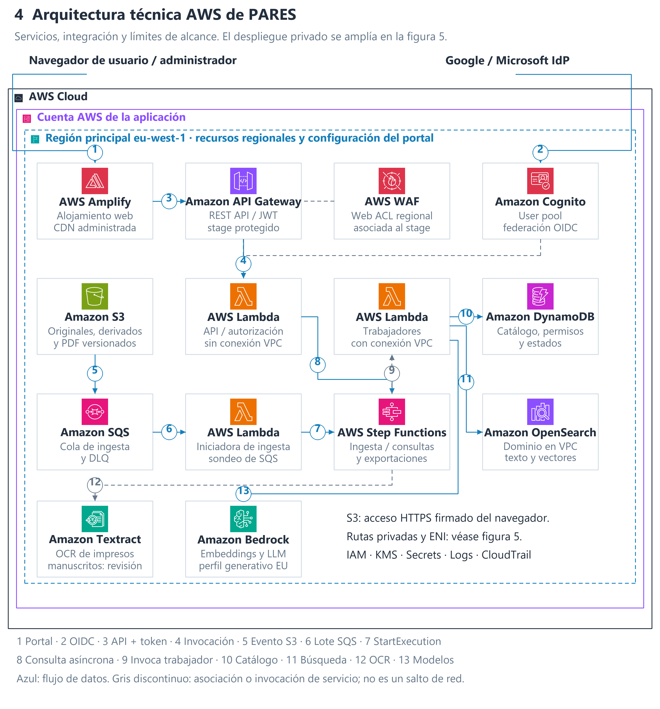

# PARES Arquitectura RAG en AWS

Actividad final de Arquitecturas con IA · PONTIA · Máster en IA, Cloud Computing & DevOps 0226.

- **Alumno:** German Dario Realpe Zambrano.
- **Contacto:** gedorz@gmail.com.
- **Última actualización:** 8 de noviembre de 2026.
- **Versión del dossier:** 1.1 · Propuesta de diseño.

## Objetivo del proyecto

Diseñar un asistente documental para PARES que permita explorar y consultar en lenguaje natural documentos escaneados fechados entre 1500 y 1600. La solución organiza hechos y fechas, genera resúmenes con referencias al documento original y permite descargar las respuestas en PDF.

La arquitectura combina búsqueda léxica y vectorial mediante RAG con un catálogo de hechos revisados. AWS es la plataforma principal; Azure se documenta como alternativa técnica equivalente. El proyecto contiene el diseño y sus diagramas; las mediciones de calidad y el despliegue quedan para una implementación posterior.

## Documentación de entrega

- [Dossier de arquitectura](Documentos/ActividadFinal.md): requisitos, justificación RAG, datos, componentes, seguridad, evaluación, operación, recuperación y costes.
- [PARES Arquitectura RAG en AWS en Google Docs](https://docs.google.com/document/d/1dp_MKH-TwlOP7IleoKUKnfJo-T_KMMHCHyUAZ1qAexE/edit): versión de entrega con figuras, tablas, índice automático y numeración de páginas.
- [Enunciado y criterios de evaluación](Documentos/diagramas/iconos-aws/actividadFinal.md): planteamiento y 19 entregables.

## Diagramas del proyecto

Los diagramas funcionales explican las capacidades y el recorrido de los datos. Las vistas técnicas AWS detallan servicios, integración y despliegue. La vista simplificada sirve como apoyo de lectura; las figuras técnicas 4 y 5 desarrollan los detalles de AWS.

| Vista | Qué explica | Imagen | Vector | Editable |
| --- | --- | --- | --- | --- |
| 1. Vista funcional | Consulta, administración, revisión y acceso al original. | [PNG](Documentos/diagramas/01-vista-funcional.png) | [SVG](Documentos/diagramas/01-vista-funcional.svg) | [draw.io](Documentos/diagramas/01-vista-funcional.drawio) |
| 2. Ingesta y publicación | Pasos I1–I8, desde la carga hasta la activación del corpus. | [PNG](Documentos/diagramas/02-flujo-ingesta.png) | [SVG](Documentos/diagramas/02-flujo-ingesta.svg) | [draw.io](Documentos/diagramas/02-flujo-ingesta.drawio) |
| 3. Consulta y exportación | Pasos Q1–Q8, recuperación de evidencia, respuesta y PDF. | [PNG](Documentos/diagramas/03-flujo-consulta.png) | [SVG](Documentos/diagramas/03-flujo-consulta.svg) | [draw.io](Documentos/diagramas/03-flujo-consulta.drawio) |
| 4. Arquitectura técnica AWS | Límites cloud/cuenta/región y flujos de integración numerados. | [PNG](Documentos/diagramas/04-arquitectura-aws.png) | [SVG](Documentos/diagramas/04-arquitectura-aws.svg) | [draw.io](Documentos/diagramas/04-arquitectura-aws.drawio) |
| Vista simplificada AWS | Componentes principales y sus responsabilidades. | [PNG](Documentos/diagramas/04-arquitectura-simple-aws.png) | [SVG](Documentos/diagramas/04-arquitectura-simple-aws.svg) | [draw.io](Documentos/diagramas/04-arquitectura-simple-aws.drawio) |
| 5. Despliegue y seguridad AWS | Tres zonas, subredes privadas, ENI, endpoints y OpenSearch. | [PNG](Documentos/diagramas/05-despliegue-seguridad-aws.png) | [SVG](Documentos/diagramas/05-despliegue-seguridad-aws.svg) | [draw.io](Documentos/diagramas/05-despliegue-seguridad-aws.drawio) |
| 6. Equivalencia técnica Azure | Servicios equivalentes y conectividad privada en una alternativa Azure. | [PNG](Documentos/diagramas/06-equivalencia-tecnica-azure.png) | [SVG](Documentos/diagramas/06-equivalencia-tecnica-azure.svg) | [draw.io](Documentos/diagramas/06-equivalencia-tecnica-azure.drawio) |

Para modificar una figura, abre su archivo `.drawio` en [diagrams.net](https://app.diagrams.net/) y actualiza sus exportaciones PNG y SVG. El dossier y Google Docs deben incorporar la misma revisión de las imágenes.

## Arquitectura técnica AWS

El portal se aloja en AWS Amplify Hosting. Amazon Cognito integra la identidad federada de Google o Microsoft; API Gateway REST y Lambda atienden las operaciones autorizadas. WAF se asocia al stage de la API.

Amazon S3 conserva originales, derivados y exportaciones. SQS desacopla la carga del procesamiento y Step Functions orquesta los trabajos. Bedrock participa en la extracción, los embeddings y la generación; DynamoDB mantiene el catálogo y los estados; OpenSearch permite recuperar texto y vectores.

### Ingesta documental

1. El administrador carga el escaneo en S3 mediante una autorización temporal.
2. Un evento S3 llega a SQS y una Lambda iniciadora registra el trabajo y arranca la orquestación.
3. Se valida y prepara el archivo. El OCR asiste en impresos compatibles; los manuscritos históricos pasan por transcripción humana.
4. Se proponen fechas, entidades y hechos, que se revisan junto a sus fuentes.
5. Tras la aprobación, se generan fragmentos y embeddings, se preparan los índices y se activa una versión coherente del corpus.

### Consulta y exportación

1. El usuario inicia sesión y explora el índice de hechos o formula una pregunta.
2. La aplicación aplica permisos, filtros y recuperación híbrida para reunir evidencia.
3. Los listados por hecho se recuperan del catálogo con paginación; un resultado semántico parcial no se presenta como listado completo.
4. Se redacta y valida una respuesta con citas, incertidumbres y campos ausentes explícitos.
5. Si se solicita, se genera el PDF a partir de la respuesta validada y se ofrece una descarga temporal autorizada.

## Despliegue privado y disponibilidad

La figura 5 representa una VPC con tres zonas de disponibilidad. Cada zona contiene una subred privada de aplicación y otra de búsqueda. Lambda aparece como servicio administrado conectado mediante Hyperplane ENI.

- **Endpoints de interfaz:** utilizan ENI, PrivateLink, DNS privado y grupos de seguridad para acceder a las API indicadas.
- **Gateway endpoints de S3 y DynamoDB:** se asocian a tablas de rutas; no utilizan ENI ni PrivateLink.
- **OpenSearch:** un único dominio distribuido entre las tres zonas, con tres nodos de datos, tres maestros y dos réplicas, según la propuesta Multi-AZ with Standby.
- **Acceso:** SG-workers, SG-vpce y SG-search delimitan la conectividad; IAM y las políticas de los recursos determinan la autorización.

La descripción completa y las referencias oficiales AWS están en las secciones 11, 14 y 16 del dossier. Los diagramas documentan un diseño alineado con esas guías; no representan una infraestructura ya desplegada o certificada.

## Organización de los archivos

| Ubicación | Contenido |
| --- | --- |
| `Documentos/ActividadFinal.md` | Dossier principal de arquitectura. |
| `Documentos/diagramas/` | Figuras PNG, SVG y fuentes editables draw.io. |
| `Documentos/diagramas/iconos-aws/` | Iconos AWS, manifiestos de procedencia y enunciado original. |
| `Documentos/diagramas/iconos-azure/` | Iconos Azure y su manifiesto de procedencia. |

La procedencia de los símbolos AWS se conserva en los manifiestos [principal](Documentos/diagramas/iconos-aws/procedencia.json) y [adicional](Documentos/diagramas/iconos-aws/procedencia-adicional.json). Los símbolos Azure disponen de su [propio manifiesto](Documentos/diagramas/iconos-azure/procedencia.json).
